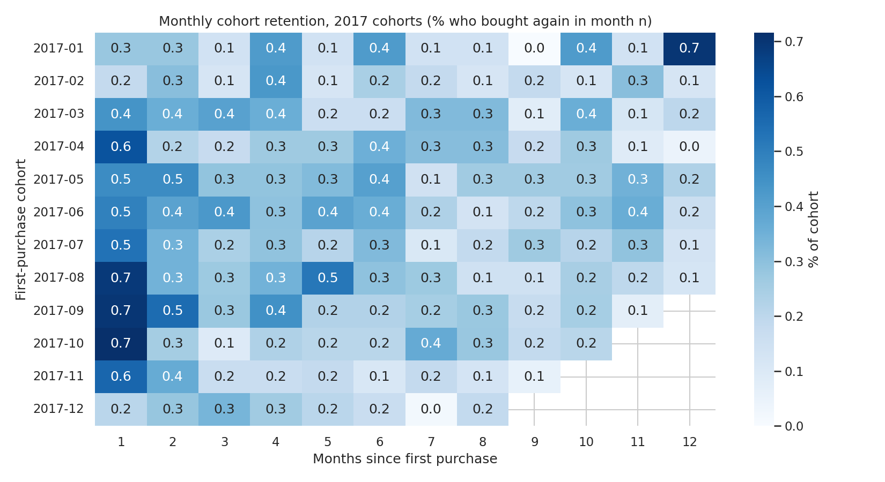

# Olist E-Commerce: Why Don't Customers Come Back?

End-to-end retention and delivery analysis of ~100k orders from Olist, a Brazilian e-commerce marketplace (2016–2018).

## Business question
Almost all Olist customers buy only once. **What drives this, and what is fixing it worth?**

Sub-questions:
1. How large is the repeat-purchase gap, and how do cohorts retain over time?
2. Do late deliveries lower review scores, and do low scores reduce repeat purchases?
3. Which states, sellers and product categories cause the most problems?
4. Which customer segments (RFM) should the business target first?

## Key findings
_Work in progress, updated as the analysis progresses._

**First SQL results** (`sql/03_first_insights.sql`, delivered orders only):
- Only **3.0%** of 93,358 customers ever placed a second order.
- **8%** of orders arrived late. Late orders average **2.57★** vs **4.29★** on time, and **45%** of late orders get a 1-star review (vs 7%).
- Late-delivery rate is highest in **MA (19.7%)**, **CE (15.3%)** and **BA (14.0%)**; RJ is the largest problem by volume (12k orders, 13.5% late).

**Retention analysis** (`notebooks/02_retention_delivery.ipynb`):
- Using a strict definition (a later-day order within 180 days), only **1.97%** of customers come back. Month-1 cohort retention averages **0.5%**.
- Customers whose first order was late returned at **1.69% vs 2.00%**, but this is **not statistically significant** (χ² p ≈ 0.18).
- **Takeaway:** late delivery damages ratings, but it is not what drives the low repeat rate. That is structural, so the next step is to find who *does* return (RFM segmentation).



## Tech stack
SQL (DuckDB) · Python (pandas, matplotlib, seaborn, scipy, scikit-learn) · Power BI (DAX, Power Query) · Git/GitHub

## Project structure
```
data/raw/        Original Olist CSVs (not committed; see below)
sql/             Cleaning and data-model queries
notebooks/       Exploratory and statistical analysis
src/             Reusable Python helpers
dashboard/       Power BI file and screenshots
reports/         Final business summary and figures
docs/            KPI definitions
```

## How to run
1. Download the dataset from Kaggle: [Brazilian E-Commerce Public Dataset by Olist](https://www.kaggle.com/datasets/olistbr/brazilian-ecommerce)
2. Unzip the CSVs into `data/raw/`
3. `pip install -r requirements.txt`
4. `python src/build_db.py` builds `data/olist.duckdb` and prints first insights
5. Open the notebooks in order (`01_…`, `02_…`)

## Author
Mayuri, M.Sc. Applied Computer Science, TH Deggendorf
